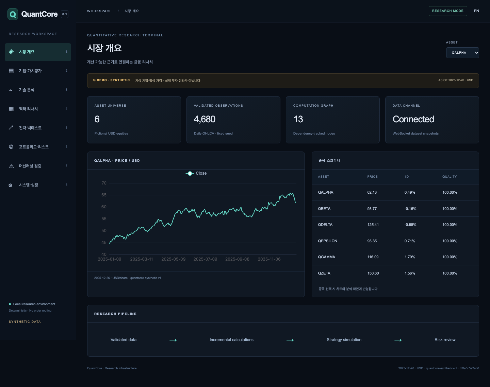

# QuantCore

재무·기술·팩터 분석, 전략 백테스트, 포트폴리오 최적화와 리스크 계산을 연결한 **로컬 금융 리서치 MVP**입니다.

**현재 데이터는 가상 기업 6개의 합성 자료입니다. 아래 수익률은 데모 엔진 검증을 위한 모의 결과이며 실제 시장 성과가 아닙니다.** 외부 금융 API·유료 서비스·실거래 계좌·LLM은 연결하지 않았습니다.

## 실행

```bash
cd /Users/kanghyeon/Desktop/Project/jane/quant
docker compose up --build
```

- 대시보드: **http://localhost:3100**
- API 문서: **http://localhost:8100/docs**
- 종료: `docker compose down` — 데이터는 named volume에 유지됩니다.

첫 실행에서 API가 샘플 자료를 생성·검증·저장합니다. API 키가 필요하지 않습니다. 이미지 빌드와 API healthy 상태, 실제 브라우저 검사는 아래 검증 기록을 참조하세요.

이 환경에서는 Docker 인증 도우미가 대기해 임시 익명 설정으로 공개 이미지를 빌드했습니다. 기존 Docker 인증 설정은 변경하지 않았습니다. 현재 생성된 이미지로 재시작할 때는 `docker compose up -d --no-build`도 사용할 수 있습니다.

Docker 대신 Python3.12+/Node24 환경에서 실행할 수 있습니다.

```bash
make setup
make demo
make api       # 터미널 1, 8100 포트
make web       # 터미널 2, 3100 포트
```

`.env.example`의 설정을 참고하세요. 선택형 `QUANTCORE_API_TOKEN`은 API 접근용이고 외부 금융 서비스 키가 아닙니다. 공개 배포 전에는 사용자 인증·TLS·권한 체계를 추가해야 합니다. 현재 Compose 포트는 localhost에만 바인딩됩니다.

## 백테스트 노트북

### 노트북 현황 — 2026-11-24 (KST)

문서 기록일은 **2026-11-24**이며, 마지막 전용 커널 전체 실행 확인은 **2026-11-24 19:44 KST**입니다. 아래는 저장된 실행본과 검증 기록을 확인한 현황입니다.

| 항목 | 현재 상태 |
|---|---|
| 파일 | `notebooks/QuantCore_Backtest.ipynb` 작성·실행 완료 |
| 저장된 실행본 | 전체18셀 중 코드9셀 실행, 그래프5개 저장, 셀 오류0개 |
| 데이터 | 가상 기업6개·합성 일봉4,680행, 자료 범위2023-01-02~2025-12-26 |
| 비교 범위 | Momentum·Mean Reversion·95% BuyHold ×6종목 =18개 비교, 이 중 전략12개·벤치마크6개 |
| 기본 평가 조건 | 마지막252봉(2025-01-09~12-26), 초기자금 $100,000, 거래비용 차감·다음 봉 시가 체결 |
| 제공 화면 | 성과표, 비용 전후 수익곡선·낙폭, 매수/매도 위치·체결 원장, 월별 수익률, 비용 민감도, 종목/전략 선택 위젯 |
| 실행 시나리오 | 기본 설정·데이터 파일 없이 메모리 생성·종목/기간/수수료 변경 모두 통과; 위젯 콜백 확인 |
| 저장 결과 대조 | 기본 설정의 전략12개 누적 수익률이 기존 실험과 정확히 일치(최대 차이0) |
| 전용 커널 | `QuantCore (Python 3.12)` / 프로젝트 `.venv`, NumPy2.3.5·Pandas2.3.3에서 실행 확인 |
| 사용 중이던 커널 | 상위 `.venv312`, NumPy1.26.4·Pandas2.3.3에서 세 시나리오 전체 실행 확인 |
| 커널 오류 조치 | pandas·ipywidgets·SQLAlchemy·PyArrow·Jinja2 등 누락 의존성 설치; 기존71개 패키지 버전 유지, 누락 모듈0개 |
| 최근 회귀 검사 | 자동 테스트71개 통과, Ruff 통과 |

기본 선택인 **QALPHA / Momentum의 비용 차감 누적 수익률은 +7.3454%**입니다. 이는 위 합성 자료의 전체 평가 기간 결과입니다. 실제 시장 데이터 연동과 실전 수익성 검증은 아직 진행하지 않았습니다.

검증 근거: [전체 시나리오](docs/notebook_validation.json) · [전용 커널 재확인](docs/notebook_primary_kernel_validation.json) · [선택 커널 실행](docs/notebook_selected_kernel_validation.json) · [패키지 보존 기록](docs/notebook_kernel_repair.json).

**[notebooks/QuantCore_Backtest.ipynb](notebooks/QuantCore_Backtest.ipynb)**를 열고, 커널 **`QuantCore (Python 3.12)`**를 선택한 뒤 **Run All**을 실행하세요. 현재 환경에는 전용 커널을 등록했습니다. Docker/API 없이 Python 엔진으로 직접 실행합니다.

다른 환경에서는 먼저 프로젝트 루트에서 `make notebook-setup`을 실행하세요. 위젯은 해당 셀을 실행하면 활성화되고, 저장된 표·그래프는 실행 전에도 확인할 수 있습니다.

- 6개 가상 종목 × Momentum/Mean Reversion/95% BuyHold의 성과표·수익률 비교
- 선택 종목의 비용 전후 수익곡선, 최대 낙폭, 자산 곡선과 매수·매도 위치
- 월별 복리 수익률, 거래 비용 민감도, 신호/체결 시각·수수료·현금·보유 수량
- 종목·전략 선택 위젯과 설정 셀의 비용·평가 기간 변경
- 기본 입력/설정일 때 저장 실험12개 수익률 대조, CSV/JSON 로컬 내보내기

자료 파일이 없으면 기존 DemoProvider로 메모리에 합성 데이터를 생성합니다. 현재 노트북도 **합성 일봉의 모의 백테스트**이며, 실제 주식 성과가 아닙니다. 내보낸 파일은 `artifacts/notebook_backtest/`에 저장합니다. 전체 실행 검사는 `make notebook-check`로 재현할 수 있습니다.

커널의 패키지 누락 오류가 나면 첫 셀에 표시되는 현재 Python과 권장 경로를 확인하세요. 이미 보완한 상위 `/Users/kanghyeon/Desktop/Project/.venv312/bin/python`을 계속 쓰는 경우 **Restart Kernel → Run All**을 실행하면 됩니다.

## 요구사항 대조와 개발 과정

두 첨부 요구사항은 동일했습니다. 중단 시점에는 Python 분석 함수 일부만 있었고 API 통합·웹 화면·테스트·결과 문서가 없었습니다. 요구사항 마지막 절의 “실행 가능한 MVP 우선”에 따라 아래 순서로 연결했습니다.

| 단계 | 구현·검증 내용 |
|---|---|
| 조사·설계 | 새 저장소 확인, Jane Street 공개 저장소23개 조사, 모듈 의존 방향·MVP 범위 결정 |
| 데이터 기반 | Pydantic 계약, UTC/가용 시각, async 수집·재시도·속도 제한, SQLite WAL·Parquet·DuckDB |
| 증분 계산 | DAG·topological order·dirty/cache/version·배치·순환 검사·구독·rolling 통계 |
| 금융 분석 | 재무17항목·기술15계열·팩터6계열·FCFF DCF·민감도·Monte Carlo |
| 전략·리스크 | Momentum/Mean Reversion·BuyHold 비교, 다음 봉 체결·비용·부분체결·Decimal 원장, 최적화3종·VaR/ES·Greeks |
| 통합·웹 | FastAPI·WS ticket·API token·rate limit, Next/React 대시보드8개 화면, 한영·모바일·단축키 |
| 연구 검증 | Ridge/평균 baseline 워크포워드, 통계·vintage, 자동 테스트·브라우저 검사·벤치마크·실행 문서 |

실제 검사에서 발견한 문제도 수정했습니다. NumPy/Pandas 조합의 대량 경고는 NumPy<2.4로 해결했고, 브라우저에서 발견한 WebSocket 전송 의존성 누락은 `wsproto`로 수정했습니다. 화면 전환 때 이전 화면 응답을 새 형식으로 해석하던 오류는 요청 조건별 응답 식별로 수정했습니다. 백업 테스트의 개발 스크립트 import 경로도 명시했습니다.

전체 기능 대조: [requirements_comparison.md](docs/requirements_comparison.md) · 상세 과정/실행 명령: [progress.md](docs/progress.md)

## 현재 작동하는 기능

- **데이터:** 가상 종목 `QALPHA/QBETA/QGAMMA/QDELTA/QEPSILON/QZETA`, 종목별780일 ×6 = **4,680 OHLCV행**, 연간 재무18건. 출처·통화·자료 유형·UTC 시각 기록, 중복 재수집0건, 변경된 기존 봉은 오류 처리.
- **재무:** 매출/EPS/FCF 성장, 이익률, ROE/ROA/ROIC, FCF/EBITDA, 부채·유동·이자보상·발생액·회전율·희석. 공식·기간·공개/가용 시각·산업 적용 조건 제공.
- **기술:** SMA/EMA/WMA/RSI/MACD/Bollinger/ATR/ADX/OBV/Stochastic/Ichimoku/Donchian/Keltner/ROC 및 **일봉 VWAP proxy**. 실제 tick VWAP와 구분합니다.
- **팩터:** value/momentum/quality/growth/low volatility/liquidity, winsorize·z-score·rank·섹터 중립·사용자 가중치. 전체 세부 팩터가 모두 구현된 것은 아닙니다.
- **가치평가:** 사용자 가정에 따른 FCFF DCF, WACC/terminal growth 민감도, 성장률 불확실성 Monte Carlo2,000회.
- **전략:** Momentum/Mean Reversion, 동일 조건의 BuyHold, 다음 봉 시가·정수 수량·현금 보존·수수료/슬리피지/스프레드/영향·부분체결. 분할/배당/상폐 handler는 별도 시나리오 테스트.
- **포트폴리오·리스크:** equal/minimum variance/risk parity, long-only·합100%·종목 상한40%, 위험 기여, Historical/Normal/MC VaR·ES·낙폭·집중·상관·가상 스트레스. BS 옵션 가격/Greeks/IV.
- **통계·ML:** 상관/공분산·OLS/Huber/PCA·block bootstrap·BH 보정, Ridge와 단순 평균 baseline의 purge/embargo 검증. 사용자 제공 거시 release/vintage의 미래 수정 차단.
- **UI:** 시장·종목, 재무/DCF, 기술, 팩터, 전략/백테스트, 포트폴리오/리스크, ML 검증, 시스템/설정. WebSocket은 과거 데이터 snapshot 갱신이며 실시간 시장 피드가 아닙니다.

## 정량 결과 — 합성 자료 모의 실험

자료 범위 **2023-01-02~2025-12-26**, seed **20261124**, UTC 일봉·가상 평일 달력입니다. 전략 평가는 마지막 **252봉: 2025-01-09~12-26**입니다. 초기 자금 $100,000, long-only 목표95%, 다음 봉 체결, 이전 봉 거래량의1% 참여 한도입니다.

편도 비용은 **수수료1bp + 슬리피지2bp + half-spread1bp + 5bp×√참여율**입니다. 비용 전/후를 각각 다시 시뮬레이션했습니다. 아래는 전체 평가 기간의 누적값이며 종목별 수익률을 포트폴리오 수익률로 합산하지 않습니다.

| 가상 종목 | Momentum 비용 전 | 비용 후 | Mean Reversion 비용 전 | 비용 후 |
|---|---:|---:|---:|---:|
| QALPHA | +8.24% | +7.35% | +10.29% | +9.55% |
| QBETA | -11.71% | -12.60% | +10.77% | +9.62% |
| QGAMMA | -0.11% | -0.74% | +14.45% | +13.44% |
| QDELTA | -4.39% | -5.07% | -9.51% | -10.10% |
| QEPSILON | +7.55% | +7.19% | -10.36% | -10.85% |
| QZETA | -24.64% | -25.56% | +24.21% | +23.09% |

모든 종목·두 전략을 손실 포함해 기록했습니다. BuyHold 대비 수익률, CAGR·Sharpe·낙폭·회전율·체결 수 등 전체 값은 [research_results.json](docs/research_results.json)에 있습니다. 합성 자료에서 좋은 결과가 나온 전략을 실제 시장의 우수 전략으로 선정하지 않습니다.

최소분산 포트폴리오의 동일 구간 **표본 내** 추정치는 일별95% Historical VaR **1.4115%**, ES **1.7639%**, 연환산 변동성 **13.4495%**입니다. 최적화 정책의 OOS 수익률을 뜻하지 않습니다.

QALPHA의 5일 수익률 예측은 8개 walk-forward 분할·모델별455개 표본입니다.

| 모델 | OOS MSE | 방향 정확도 |
|---|---:|---:|
| 학습 평균 baseline | 0.00064007 | 55.38% |
| Ridge | 0.00064445 | 52.09% |

Ridge가 baseline을 개선하지 못했습니다. 목표가 겹쳐 표본은 독립이 아니며, 이 비교는 수익성이나 통계적 유의성을 증명하지 않습니다.

## 테스트와 성능 측정

2026-11-24 실제 로컬 실행 결과:

| 검사 | 결과 |
|---|---|
| Python 자동 테스트 | **71개 통과**, 5.52초, test transport deprecation 경고1개 |
| 문장 커버리지 | **98.40%**, `quantcore` + `apps/api` 범위; UI/스크립트 포함 전체 커버리지 아님 |
| 속성 검사 | DAG 동등성 최대80개 생성 사례, put-call parity 최대30개 사례 |
| Ruff | 통과 |
| Mypy | core/events/incremental/security **8파일** 통과; 전체 Pandas 코드 검사 아님 |
| Next.js | TypeScript 포함 production build 통과 |
| 실제 Chromium | **10개 사용자 시나리오 통과**, JavaScript 오류0개, 모바일 가로 overflow 없음 |
| Docker Compose | API healthy·웹 실행 확인, 실제 API/프록시/WS 연동 검사 통과 |

금융 기준값, 현금/보유량 보존, 다음 봉 체결, 미래 봉/공시 수정 차단, 중복 수집, 잘못된 입력, 제약 불가능, SQL 입력, 백업 복구, 모듈 순환, API 인증/일회용 WS ticket을 검사했습니다. 실제 브라우저 및 컨테이너 결과는 [performance_report.md](docs/performance_report.md)에 별도로 기록합니다. GitHub Actions는 구성했으며 원격 CI 실행을 주장하지 않습니다.

Apple M3 Pro/arm64, Python3.12.12의 실제 마이크로벤치마크:

| 항목 | 측정 |
|---|---:|
| 100자산·301노드·자산별2,000개 이력, 전체 재계산 p50 | 1.904ms |
| 같은 DAG에서 입력1개 변경, 증분 p50 | 0.264ms |
| 해당 작업의 중앙값 속도비 | **7.22배** |
| 재계산 derived node 수 | 전체201 → 증분3 |
| 결과 최대 절대 오차 | **0.0** |
| TestClient API p50 / p95 | 19.684 / 20.650ms |
| 합성 수집·초기화·Parquet export 포함 처리량 | 약7,197행/초 |

특정 단일 프로세스 작업의 측정입니다. 증분 엔진이 모든 작업에서7.22배 빠르다는 뜻이 아닙니다. p99.9는100/150개 표본의 보간값으로 운영 SLO를 보장하지 않습니다. p50/95/99/99.9, DB·CPU·RSS·패키지/환경은 [benchmark_results.json](docs/benchmark_results.json)에 있습니다.

## 남은 개발

실제 데이터 공급자·거래소 달력/기업행사·장중/호가·공매도/펀딩, 전체 재무 점수와 가치평가 모델, HRP/BL/CVaR·효율적 경계, 실제 역사적 스트레스, 대형 ML/SHAP/MLflow, 뉴스/공시·LLM, KRW 환산, 다중 사용자 인증은 남아 있습니다. **기관급 전체 요구사항 완료를 주장하지 않습니다.**

공식 공급자 문서 조사와 비활성 이유: [provider_review.md](docs/provider_review.md). 이전 프로젝트 API 키와 실제 백테스트 결과를 가져오지 않았습니다. 아직 실제 시장 데이터 기반 검증은 없습니다.

## 재현과 문서

```bash
make test
make check
make report
make benchmark
.venv/bin/python scripts/validate_runtime.py   # 로컬 report 생성 + API 실행 후
.venv/bin/playwright install chromium
.venv/bin/python tests/end_to_end/browser.py   # API/웹 실행 후
```

Python 의존성은 `requirements.lock` 제약으로, 웹은 `package-lock.json`으로 고정합니다. 시장 snapshot 해시는 결과 JSON에 기록됩니다. 코드는 source이고 `datasets/`와 `artifacts/`는 로컬 생성물입니다.

[아키텍처](docs/architecture.md) · [설계 결정](docs/system_design.md) · [데이터 사전](docs/data_dictionary.md) · [공식·적용 한계](docs/financial_formulas.md) · [API](docs/api_reference.md) · [DB/백업](docs/database_schema.md) · [백테스트](docs/backtesting_methodology.md) · [리스크](docs/risk_methodology.md) · [모델 검증](docs/model_validation.md) · [보안](docs/security.md) · [알려진 제약](docs/known_issues.md) · [공개 저장소 조사](docs/reference_analysis.md)

## 실행 화면

Docker 실행본을 실제 Chromium에서 확인한 화면입니다. 표와 그래프는 모두 합성 데모 자료입니다.


