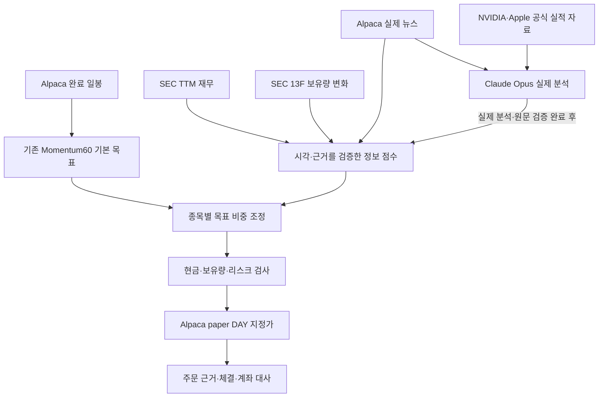

# 재무·기관·뉴스 주문 연동과 어닝콜/LLM 연결

2026-11-25 KST 갱신. 실제 정보 분석을 paper 목표 비중에 연결했고, 이후 사용자 요청으로 **Anthropic Claude Opus 5.5(`claude-opus-5-5`)를 실제 연결**했습니다. 실제 뉴스·공식 실적 발표문을 분석하고 원문 인용을 다시 검증했습니다. [정량 검증 기록](claude_opus_validation.json)을 참조하세요.

## 현재 처리 흐름



분석 API는 조회·미리 보기만 제공합니다. 주문은 기존 별도 paper 작업이 실행합니다. 기존 일봉 주기, 5개 슬롯, $100,000 현금 기준 예산과 리스크 제한을 유지합니다. 정보 갱신/LLM 작업은 같은 5분 스케줄러에서 별도 프로세스로 시작하며, 주문·리스크 원장 잠금을 보유하지 않습니다. 소스별 TTL과 독립 수집 잠금으로 중복 실행을 방지합니다.

## 비중 계산 규칙

이 계산은 **사전에 정한 배분 규칙**입니다. 학습된 예측 모델, 상승 확률, 성과가 검증된 가중치로 표시하지 않습니다.

| 구성 | 점수 계산 | 가중치 |
|---|---|---:|
| 재무 | 매출 YoY/20%, ROE/25%, 영업이익률/25%를 각각 −1~1로 제한한 평균. 최소2개 실측 지표 필요 |45%|
| 기관 | 최신 보통주 신고량/분할 보정 이전량의 변화율을20%로 나눈 후 −1~1 제한. 보고기간 경과150일 이내, 인접 분기만 사용 |20%|
| 뉴스 | 최근48시간 기사 중 실제 `risk` 주제 기사 수로 `−min(건수/3,1)`. LLM 설정 후에는 검증된 감성70%+위험 언급30% |25%|
| 실적 자료 LLM | 현재 분기의 전체 문서 조각 분석이 완료된 경우에만 감성 해석 사용. 녹취록→CFO 설명→실적 발표문 우선순위 |10%|

미확보 항목은 **null로 남기고 해당 가중치를 제외**합니다. 실제 관측이 없는 것을 중립 감성으로 만들지 않습니다. 포함된 가중치를 다시 정규화한 합성 점수 `s`로 배율 `clip(0.75+0.25×s, 0.5, 1)`을 계산합니다. 모든 정보가 없으면 기존 가격 전략을 유지하고 데이터 없음으로 기록합니다. 데이터 해시·형식 오류가 있으면 새 매수를 차단합니다.

기존 가격 전략의 기본 목표0 또는95%에 배율을 곱합니다. 종목별 $20,000 슬롯의95%인 $19,000에 배율을 적용하고 매수 지정가로 나눠 정수 수량을 계산합니다. 보유량·미체결·현금·리스크가 최종 수량을 제한합니다. 정보가 긍정적이어도 기존 가격 전략의 최대 비중을 초과하지 않습니다.

정책 버전은 `configs/decision_policy.json`의 내용으로 정합니다. 원장에는 정책 전환·입력·주문 전 근거를 저장합니다. 버전 불일치 시 새 주문을 막고, 활성화 과정에서 본인 미체결 주문만 취소 확인한 뒤 새로운 정책 ID를 사용합니다. 취소와 체결이 경합하면 실제 체결 수량부터 다시 대사합니다. 자동 작업은 장 시작5분을 넘기면 새 진입을 다음 세션으로 미룹니다. 사용자가 명시적으로 요청한 일회성 재진입은 별도 요청 ID·사전 원장 기록·최근 완료 정규장 분봉 기준가로 실행하며, 같은 리스크 검사를 적용합니다. 일반 자동 실행 시간은 변경하지 않습니다.

## 실제 공식 자료 수집

공식 IR 페이지가 공개 JavaScript에서 사용하는 문서 목록 GET 피드를 재사용합니다. NVIDIA·Apple의 최신 두 분기에서 **실적 발표문4건·재무자료 PDF2건**, 총6건을 수집·파싱했습니다. NVIDIA와 Apple의 실제 두 분기 발표문을 비교해 위험·수요·가이던스·설비투자·경쟁 용어의 언급 변화도 제공합니다. 이는 용어 빈도 비교이며 전망 상향/하향이나 감성 변화로 해석하지 않습니다.

- NVIDIA: FY2027 Q3/Q2 실적 발표문2건. 공식 녹취록·CFO 자료 링크는 존재하지만 문서 CDN의 robots 조회가403이므로 해당 다운로드는 보류했습니다. 접근 제한을 우회하지 않습니다.
- Apple: FY2026 Q4/Q3 실적 발표문2건과 연결 재무자료2건. 확인한 공식 목록에는 녹취록이 없습니다. 웹캐스트를 녹취록으로 바꾸거나 음성을 임의 다운로드하지 않습니다.
- 실제 발표문에 명시된 발언자만 CEO/CFO로 연결합니다. 구분할 수 없으면 미확인으로 보존합니다. 녹취록 파서는 준비 발언·Q&A·경영진·애널리스트 구분을 지원하지만 현재 실제 녹취록 수집 성공을 주장하지 않습니다.
- 자료 공개 시각과 실제 발언·종료 시각은 확인되지 않아 null입니다. IR 보고일을 녹취록 공개 시각으로 대신하지 않습니다. 사용 가능 시각은 실제 수집·파싱 완료 이후입니다. 원문·전체 텍스트는 비공개 로컬 캐시에만 저장합니다.

## LLM 연결 구현

기본 연결은 Anthropic Messages API의 Claude Opus이며, OpenAI Responses API와 로컬 Ollama도 지원합니다. 기존 httpx를 사용하며 모델 SDK를 추가하지 않았습니다. PDF 처리를 위해서만 `pypdf6.21.4`를 realdata 의존성과 lock에 추가했습니다.

모델은 엄격한 JSON 스키마로 감성·가이던스·위험·Q&A·수치·주제 주장을 반환합니다. 원문 segment ID, 실제 발언자, 원문 인용과 위치를 검사합니다. 유일한 정확 인용이면 프로그램이 위치를 계산하며, 인용이 없거나 모호한 위치·존재하지 않는 발언자는 거부합니다. 원문 속 명령은 지시로 취급하지 않으며 도구·코드·매매 주문 기능을 모델에 제공하지 않습니다.

- 입력 문서 해시·조각·모델·프롬프트 버전으로 중복 분석을 방지합니다. 장문은 연속 조각으로 처리하고 전체 조각이 완료된 현재 분기만 비중에 반영합니다.
- 요청 전 의도를 SQLite에 저장합니다. 시간 초과·거절·불완전 출력·원문 불일치는 성공으로 표시하지 않으며 같은 요청을 자동 재전송하지 않습니다.
- 한 번에 최대3건, 하루 최대20건의 모델 요청을 제한합니다. OpenAI 요청은 `store=false`, 출력 토큰 상한을 사용합니다. 원문 검증 통과가 의미 해석의 정확성을 보장하지는 않으므로 모델 해석으로 명시합니다.
- 실제 Opus 분석을 실행했습니다. 현재까지의 분석 수·출력 근거 수·제공자 보고 토큰량은 `claude_opus_validation.json`에 기록합니다. 테스트 응답을 운영 자료에 넣지 않습니다. 실제 확보한 어닝 자료는 발표문이며 전체 어닝콜 녹취록/Q&A로 표시하지 않습니다.

## 현재 모델 설정

프로젝트 로컬 `.env`에서 설정합니다. 비밀키를 채팅·README·Git에 넣지 않습니다.

```dotenv
QUANTCORE_LLM_ENABLED=true
QUANTCORE_LLM_PROVIDER=anthropic
QUANTCORE_LLM_MODEL=claude-opus-5-5
ANTHROPIC_API_KEY=<로컬에서만 설정>
QUANTCORE_LLM_REMOTE_ALLOWED=true
```

`REMOTE_ALLOWED=true`는 원문을 원격 모델에 보내고 API 비용을 발생시키는 동의 설정입니다. 사용자의 실제 연결 요청에 따라 현재는 true로 설정했습니다. 로컬 모델을 선택하면 `QUANTCORE_LLM_PROVIDER=ollama`, 실제 설치한 `QUANTCORE_LLM_MODEL`, `OLLAMA_HOST=http://127.0.0.1:11434`를 사용합니다. 로컬 경로는 루프백 HTTP만 허용합니다. Anthropic/OpenAI 키는 해당 공식 제공자에만 보내며 서로 전달하지 않습니다. 모델 설치·다운로드는 수행하지 않았습니다.

```bash
.venv/bin/python scripts/collect_earnings.py
.venv/bin/python scripts/analyze_information.py
.venv/bin/python scripts/validate_information_integration.py
```

설정 후 자동 갱신이 실제 모델 분석을 실행합니다. LLM 데이터가 없어도 재무·기관·실제 뉴스 위험 언급은 현재 비중 계산에 사용합니다. 웹의 **뉴스·기관 공시**에서 목표 비중, 항목별 점수/데이터 없음, 정책·기준 시각, 공식 자료, 분기 언급 비교, LLM 근거를 확인합니다. **모의투자 현황**에는 제출 전에 저장한 정보 비중 근거를 표시합니다.

## 검증과 성과 해석

실제 자료로 주문 계획을 검증했고 정책 활성화 과정에서 리스크 검사와 브로커 접수 상태를 확인했습니다. 세부 운영 관측은 로컬 검증 기록에 보관합니다.

기존252세션 및126세션 연구를 재실행해 기존 Momentum 리스크 적용−5.754559%, 선택 전략−3.819483%를 유지했습니다. 새 정보 관측은 과거 시점에 존재하지 않으므로 당시 백테스트에 소급하지 않았습니다. 새 정보 배분 규칙의 수익 개선을 검증한 결과는 아직 없으며 앞으로 쌓이는 관측으로 평가해야 합니다.

공식 연결 기준: [OpenAI quickstart](https://developers.openai.com/api/docs/quickstart), [Structured Outputs](https://developers.openai.com/api/docs/guides/structured-outputs), [NVIDIA IR](https://investor.nvidia.com/financial-info/financial-reports/), [Apple IR](https://investor.apple.com/investor-relations/default.aspx).

## 사용자 수동 청산과 명시적 재진입

확인되지 않은 외부 체결은 주문을 계속 차단합니다. 사용자가 확인한 특정 종목·수량·시간 구간의 전량 청산만 브로커의 완료 주문과 실제 FILL을 대조해 별도 승인 테이블에 저장할 수 있습니다. 기존 자동 주문과 실현손익을 삭제하거나 초기화하지 않습니다. 수동 매도는 손익·보유량에 반영하되 자동 주문의 체결률에는 포함하지 않습니다.

로컬 `scripts/run_manual_paper.py`는 명시적인 승인/재진입 명령만 처리하며 웹이나 스케줄러에서 호출하지 않습니다. 승인 전 SQLite 백업을 보존합니다. 확인된 체결과 손익은 로컬 감사 기록에 보관합니다. 원인이 해소되고 전체 수량 대사가 일치한 해당 오류만 해제했으며, STOP·일일 손실·낙폭 정지는 임의 초기화하지 않습니다.

일회성 요청은 신호에 마지막 완료 일봉만 사용하고 주문 가격/수량에 현재 정규장의 완료 IEX 분봉을 사용합니다. 1분 공개 지연을 가정하며 실제 수집 완료 이후, 분봉 종료 후5분 이내만 허용합니다. 요청 ID·기준가·원문 해시·배분·리스크를 제출 전에 저장합니다. 같은 요청 ID를 다시 실행하면 기존 상태만 반환하며 새 주문을 만들지 않습니다. 제출 중 장애는 자동 재전송하지 않습니다.
