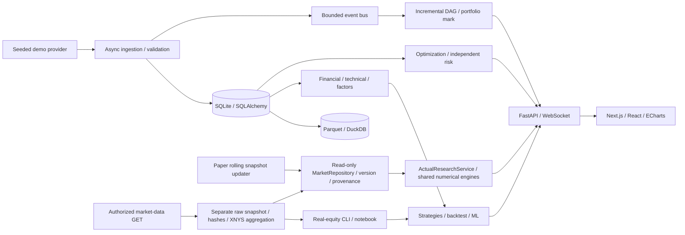

# Architecture

QuantCore is a modular monolith. Python 3.12 runs the data and numerical engine; FastAPI exposes a research-only API. Next.js serves the dashboard and proxies API requests. SQLite is authoritative; Parquet is an atomic analytical snapshot queried with DuckDB.

Dependencies flow from `apps → research service → analytics/data → core`. Analytics do not import apps or the research service. Strategies produce target weights; the simulator owns execution/accounting. Risk does not depend on the optimizer. A source failure is isolated from other source tasks; event consumer failures are recorded and cannot silently create a successful startup.

The current production-style event path is demo batch → graph prices → individual marked values → portfolio value. Factor, technical and covariance calculations use cached/batch functions; the entire analytical stack is **not** yet an incrementally maintained DAG. Graph topology is checked using deterministic DFS each stabilization; large graph maintenance overhead remains to profile.

The API selects `demo` or `alpaca` explicitly. Alpaca mode reads both validated research history and the rolling paper snapshot through MarketRepository; it does not populate fictional assets/fundamentals in the demo SQLite database. Compatible overlaps are merged without changing frozen inputs; conflicting OHLCV/times/corporate actions fail for review. Source hashes and portable snapshot IDs define the dataset version. A changed version invalidates analysis caches and the UI refetches on the next WS snapshot. The actual API reuses indicator/backtest/optimizer/risk/statistical/ML engines, holds no broker key, and cannot submit orders.

The current actual-data deployment uses a read-only dataset mount and an unprivileged UID matching the host collector, including future files created with umask077. `make real-dashboard` supplies the host UID/GID; base Compose remains a keyless demo. Missing actual financial data is returned as missing, never synthesized. Additional providers, distributed queues, Postgres/Timescale/Redis and heavy ML remain deferred. This is a local research MVP, not a claim to reproduce Jane Street's internal architecture.
